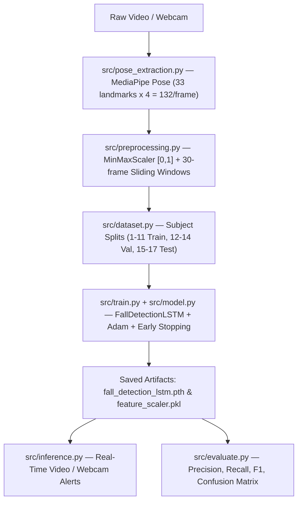

# Understanding the AI Fall Detection System: A Complete Beginner's Guide

Welcome! If you are a computer science student who knows basic programming (loops, arrays, functions, maybe a bit of Python) and wants to understand how this **AI-Based Human Fall Detection System** works from first principles, this guide is for you.

We will go from *"Why does this problem matter?"* all the way to *"How does PyTorch turn webcam frames into a fall alert?"*—without skipping the intuition behind any step.

---

## Table of Contents

1. [What Problem Are We Solving?](#1-what-problem-are-we-solving)
2. [Why Is Fall Detection Important?](#2-why-is-fall-detection-important)
3. [What Is Computer Vision?](#3-what-is-computer-vision)
4. [What Is Human Pose Estimation?](#4-what-is-human-pose-estimation)
5. [What Is MediaPipe?](#5-what-is-mediapipe)
6. [What Are Landmarks?](#6-what-are-landmarks)
7. [How Are Landmarks Converted to Features?](#7-how-are-landmarks-converted-to-features)
8. [What Is Sequential Data?](#8-what-is-sequential-data)
9. [What Is an LSTM?](#9-what-is-an-lstm)
10. [Why LSTM Instead of CNN?](#10-why-lstm-instead-of-cnn)
11. [How Does PyTorch Work in This Project?](#11-how-does-pytorch-work-in-this-project)
12. [How Does Training Work?](#12-how-does-training-work)
13. [How Does Prediction (Inference) Work?](#13-how-does-prediction-inference-work)
14. [How Do We Measure Performance?](#14-how-do-we-measure-performance)
15. [The Big Picture: Putting It All Together](#15-the-big-picture-putting-it-all-together)

---

## 1. What Problem Are We Solving?

Imagine an elderly person living independently at home. They walk to the kitchen to grab a glass of water, slip on a rug, and fall hard on the floor. If they hit their head or fracture a hip, they may be unable to stand up or reach a phone.

**Falls are the leading cause of injury-related hospitalizations and accidental injury deaths among older adults.**

### What the World Health Organization (WHO) Data Shows

According to the World Health Organization (WHO):

- **~684,000 people die from falls globally every year**, making falls the **second leading cause of unintentional injury death** worldwide (behind only road traffic injuries).
- **~37.3 million falls each year** are severe enough to require medical attention.
- **Adults aged 60 and older** suffer the highest proportion of fatal and severe non-fatal falls.

### Current Monitoring Gaps

If falls are so dangerous, why isn't this problem already solved? Current solutions have major blind spots:

| Existing Approach | How It Works | The Gap / Limitation |
|---|---|---|
| **Wearable panic buttons** | A pendant or wristband with an SOS button | People forget to wear them, take them off to sleep/shower, or are **unconscious/disoriented** after a fall and cannot press the button. |
| **Smartwatch fall sensors** | Accelerometers detect sudden impact | Batteries die, devices can be uncomfortable, and sudden arm movements (like clapping or dropping the watch) cause false alarms. |
| **Manual CCTV monitoring** | Human staff watch live camera feeds | Impossible to scale for millions of homes, expensive, prone to human fatigue, and **deeply invasive** to watch someone 24/7. |
| **Pressure mats / bed sensors** | Detect when weight leaves a bed or hits a mat | Only cover small areas (like beside a bed), not the whole room or hallway. |

### How AI Can Help

Instead of relying on a human watching a screen or a person remembering to wear a sensor, **Artificial Intelligence (AI)** can watch a standard camera feed automatically, 24 hours a day, without getting tired.

Even better, our system uses a **privacy-preserving design**:
1. It reads a video frame.
2. It extracts only **33 invisible skeleton points** (just numbers representing joint positions).
3. It throws away the actual video pixels and asks a neural network: *"Based on how these body joints moved over the last second, did this person just fall?"*

No human ever has to stare at private video footage, and an alert can be triggered the moment a fall occurs.

---

## 2. Why Is Fall Detection Important?

### The Scale of the Risk

- **1 in 3 adults over age 65 falls each year**, and after one fall, the risk of falling again doubles.
- As global life expectancy rises, millions more seniors are **aging in place** (living alone in their own homes rather than assisted-living facilities). Living alone means that if a fall happens, there may be **nobody nearby to hear the crash or call for help**.

### Why Response Time Is Critical (The "Long Lie")

In emergency medicine, there is a dangerous phenomenon known as a **"long lie"**—remaining on the floor for an hour or more after a fall because you cannot get up.

A fall itself might cause a sprain or fracture, but **waiting hours for help** causes secondary medical emergencies:
- **Dehydration and hypothermia** (body temperature dropping on a cold floor)
- **Rhabdomyolysis** (muscle breakdown from lying motionless in one position, which can damage kidneys)
- **Pressure ulcers** and severe psychological trauma (fear of falling again, leading to loss of independence)

Studies consistently show that getting medical help within minutes instead of hours dramatically improves survival and full recovery rates.

### Healthcare Cost Reduction Potential

Falls are enormously expensive for families and healthcare systems. When a fall goes undetected for hours, a manageable injury often escalates into an ICU stay, major surgery, and long-term nursing care. Automated, low-cost camera-based fall detection:
- Uses ordinary cameras (no expensive hospital-grade radar or specialized wearables required).
- Enables rapid intervention, shortening hospital stays and reducing emergency readmissions.
- Helps older adults stay independent in their own homes longer with peace of mind for their families.

---

## 3. What Is Computer Vision?

When you look at a photo of a friend waving, your brain instantly understands: *"That's Sarah, she's standing in a living room, and her arm is raised."*

When a computer opens that exact same photo, it does **not** see Sarah or a living room. It sees a giant 3D grid of numbers!

```text
What YOU see:                 What the COMPUTER sees (RGB pixels):
                              [ [212, 189, 170], [210, 187, 168], ... ]
      O   <- Person           [ [198, 175, 155], [ 45,  82, 140], ... ]
     /|\                      [ [ 44,  80, 138], [ 46,  83, 141], ... ]
     / \                      ... (hundreds of thousands of numbers)
```

For a standard `640 × 480` color video frame, there are `640 × 480 × 3 = 921,600` numbers—and at 30 frames per second (FPS), that is **27.6 million numbers every single second**.

**Computer Vision (CV)** is the field of AI dedicated to teaching computers how to extract meaningful understanding from raw pixel grids in images and videos.

### Real-World Applications of Computer Vision

- **Self-driving cars:** Detecting pedestrians, lane markings, traffic lights, and other vehicles in real time.
- **Face recognition:** Unlocking your phone or tagging people in photos.
- **Medical imaging:** Spotting tumors in X-rays, MRIs, and CT scans.
- **Sports analytics:** Tracking ball trajectories and player movement.

### Our Use Case: Analyzing Human Movement from Video

In this project, Computer Vision is our **eyes**. We use **OpenCV** (`cv2`) to read video frames one by one from a file or webcam, and then pass each frame to a pose estimation model that finds the human body in that sea of pixels.

---

## 4. What Is Human Pose Estimation?

**Human Pose Estimation** is a specific Computer Vision task whose goal is simple to state and tricky to solve: **given an image or video, find the exact locations of a person's body joints** (nose, shoulders, elbows, hips, knees, ankles, etc.) and connect them into a digital skeleton.

### A Brief History: From Motion-Capture Suits to AI

1. **Manual Annotation & Motion-Capture Suits (1980s–2000s):**
   Early biomechanics labs and movie studios glued reflective ping-pong balls onto actors wearing tight black spandex suits surrounded by special infrared cameras. Accurate, yes—but completely impractical for grandma's living room!
2. **Classical Computer Vision (2000s–Early 2010s):**
   Researchers hand-crafted mathematical rules (like *Histogram of Oriented Gradients* and *Deformable Part Models*) to guess where limbs might be based on edges and shapes. These broke easily whenever lighting changed, clothes were baggy, or furniture partially blocked the person.
3. **Deep Learning Era (2014–Present):**
   Neural networks like **DeepPose**, **OpenPose**, and Google's **BlazePose (MediaPipe)** learned from hundreds of thousands of labeled human photos. Now, an AI can look at an ordinary webcam image—no special suit, no special camera—and accurately estimate human joints in milliseconds.

### 2D vs. 3D Pose Estimation

| Feature | 2D Pose Estimation | 3D Pose Estimation |
|---|---|---|
| **Coordinates per joint** | `(x, y)` | `(x, y, z)` |
| **Meaning** | Position on the flat image (left/right, up/down) | Adds **depth** (`z`)—how close or far the joint is relative to the camera/hips |
| **Example** | Tells you the person's head is low on the screen | Also tells you whether they are leaning *toward* the camera or lying *flat* sideways |

Our project uses **3D pose estimation** (plus a visibility confidence score per joint), giving our fall detector richer spatial clues!

### Applications Beyond Fall Detection

- **Physical therapy & rehab:** Measuring whether a patient is bending their knee to the right angle during home exercises.
- **Fitness apps:** Counting squats or push-ups and checking posture form.
- **Sign language translation:** Tracking hand, arm, and upper-body movements.
- **Gaming & VTubers / Animation:** Driving 3D character avatars from a cheap webcam without a mocap studio.

---

## 5. What Is MediaPipe?

**MediaPipe** is an open-source machine learning framework created by **Google** for building fast, real-time perception pipelines (tracking faces, hands, objects, and full-body poses).

Inside MediaPipe, we use **MediaPipe Pose** (powered by Google's **BlazePose** architecture), which detects **33 full-body landmarks** from a single RGB frame.

### How MediaPipe Pose Works Internally (Simplified)

Running a heavy joint-detection neural network across the entire image on every frame would be slow. MediaPipe stays fast using a clever two-stage pipeline:

```text
  Video Frame
       │
       ▼
┌─────────────────────────────────────────┐
│ Stage 1: Person / Face Region Detector  │  (Finds WHERE the person is in the frame
│         (BlazePose Detector)            │   and crops a bounding box around them)
└─────────────────────────────────────────┘
       │
       ▼  (Cropped person image)
┌─────────────────────────────────────────┐
│ Stage 2: Pose Landmark Model            │  (Predicts all 33 x, y, z, visibility
│         (Landmark Refinement)           │   coordinates inside that region)
└─────────────────────────────────────────┘
       │
       ▼
  33 Landmarks + Skeleton
```

Even smarter: in video mode (`static_image_mode=False`, which we configure in `src/pose_extraction.py` and `src/inference.py`), **Stage 1 doesn't even have to run on every frame!** Once MediaPipe finds the person in frame 1, it uses the landmarks from frame `t` to predict the bounding box for frame `t+1` (tracking). It only re-runs full detection if tracking confidence drops below `0.5`.

### Why We Chose MediaPipe for This Project

1. **Speed:** Runs smoothly in real time (~30 FPS) even on a regular laptop CPU—no expensive GPU required for pose extraction.
2. **Accuracy:** Reliable 33-point full-body skeleton, including depth (`z`) and per-joint visibility scores.
3. **Free & Open-Source:** Easy to install via `pip` (`mediapipe`) with zero licensing fees.
4. **Well-Documented & Dataset-Compatible:** Widely used in academia; in fact, the **UP-Fall 3D Skeletons dataset** we support uses MediaPipe BlazePose landmarks directly!

---

## 6. What Are Landmarks?

A **landmark** is simply a specific anatomical keypoint on the human body (like the tip of your nose, your left shoulder, or your right ankle).

MediaPipe Pose tracks **33 landmarks**, numbered from index `0` to `32`.

### What Each Landmark Contains

For every single one of those 33 points, MediaPipe outputs **4 numbers**:

1. **`x`** — Horizontal position across the image, normalized to `[0.0, 1.0]`:
   - `0.0` = far left edge of the frame
   - `1.0` = far right edge of the frame
2. **`y`** — Vertical position from top to bottom, normalized to `[0.0, 1.0]`:
   - `0.0` = very **top** of the frame
   - `1.0` = very **bottom** of the frame
   *(Careful! In computer images, `y` increases as you go **down**, the opposite of math class graphs!)*
3. **`z`** — Relative depth (distance toward or away from the camera, centered around the midpoint of the hips):
   - Negative `z` = closer to the camera than the hips
   - Positive `z` = farther from the camera than the hips
4. **`visibility`** — Confidence score in `[0.0, 1.0]` estimating how likely it is that the joint is actually visible (not hidden behind furniture or another limb).

### Body Map of Key MediaPipe Landmarks

```text
                       [0] Nose
                 (1-6 Eyes, 7-8 Ears, 9-10 Mouth)
                           │
           [12] R.Shoulder─┼─L.Shoulder [11]
                 /         │         \
                /          │          \
       [14] R.Elbow        │        L.Elbow [13]
              /            │            \
     [16] R.Wrist          │          L.Wrist [15]
    (18,20,22 R.Hand)      │       (17,19,21 L.Hand)
                           │
             [24] R.Hip────┴────L.Hip [23]
                 │                   │
                 │                   │
            [26] R.Knee         L.Knee [25]
                 │                   │
                 │                   │
           [28] R.Ankle        L.Ankle [27]
          (30 R.Heel,          (29 L.Heel,
           32 R.Foot)           31 L.Foot)
```

*(Note: "Left" and "Right" are from the **person's own perspective**, just like anatomical left/right.)*

### Quick Reference of All 33 Landmark Indices

- **Face (`0–10`):**
  - `0`: Nose
  - `1–3`: Left eye (inner, center, outer)
  - `4–6`: Right eye (inner, center, outer)
  - `7`: Left ear, `8`: Right ear
  - `9`: Mouth (left), `10`: Mouth (right)
- **Upper Body (`11–22`):**
  - `11`: Left shoulder, `12`: Right shoulder
  - `13`: Left elbow, `14`: Right elbow
  - `15`: Left wrist, `16`: Right wrist
  - `17–22`: Left/right pinky (`17, 18`), index (`19, 20`), and thumb (`21, 22`)
- **Lower Body (`23–32`):**
  - `23`: Left hip, `24`: Right hip
  - `25`: Left knee, `26`: Right knee
  - `27`: Left ankle, `28`: Right ankle
  - `29`: Left heel, `30`: Right heel
  - `31`: Left foot index (toe), `32`: Right foot index (toe)

---

## 7. How Are Landmarks Converted to Features?

Neural networks do not natively understand Python objects like `landmark.x` or `landmark.y`. They take **flat arrays (vectors/tensors) of numbers**.

In `src/config.py` and `src/pose_extraction.py`, we convert the 33 landmarks of a single video frame into one flat list of numbers:

$$\text{33 landmarks} \times \text{4 values per landmark } (x, y, z, \text{visibility}) = \mathbf{132\text{ numbers per frame}}$$

This 132-element 1D array is called our **feature vector**.

```text
Landmark 0 (Nose)      Landmark 1 (L.Eye Inner)           Landmark 32 (R.Foot)
┌───────────────────┐  ┌───────────────────┐              ┌───────────────────────┐
│ x0, y0, z0, vis0  │, │ x1, y1, z1, vis1  │,   . . .   , │ x32, y32, z32, vis32  │
└───────────────────┘  └───────────────────┘              └───────────────────────┘
|<---------------------------------- 132 numbers ---------------------------------->|
```

### Think of It as a Numerical Fingerprint of a Pose

Just like a fingerprint uniquely identifies a person, this 132-number vector is a **mathematical snapshot of the person's posture** at one exact moment in time—stripped of background clutter, clothing color, or lighting!

### Concrete Example: Standing vs. Fallen Pose

Look at what happens to the `y` (vertical) coordinates of just three key landmarks when someone stands upright versus lies on the floor after a fall (remember: `y = 0.0` is the **top** of the image, `y = 1.0` is the **bottom**):

| Landmark | Index | Standing Upright (`y`) | Lying on Floor (`y`) | What Changed? |
|---|---|---|---|---|
| **Nose** | `0` | `0.20` (near top) | `0.84` (near bottom) | Head dropped dramatically! |
| **Left Shoulder** | `11` | `0.32` | `0.82` | Shoulders are now at almost the same height as the feet! |
| **Left Hip** | `23` | `0.55` | `0.85` | Center of mass dropped low. |
| **Left Ankle** | `27` | `0.90` (near floor) | `0.88` (still near floor) | Head and ankles now share nearly the same `y`! |

When the person is standing, there is a big vertical spread between `nose.y` (`0.20`) and `ankle.y` (`0.90`). After a fall, `nose.y`, `shoulder.y`, `hip.y`, and `ankle.y` all collapse into a horizontal line near the bottom of the frame (`~0.82–0.88`).

---

## 8. What Is Sequential Data?

**Sequential data** is any data where **order matters**—if you shuffle the items, you destroy the meaning.

### Everyday Examples

1. **Sentences:**
   - `"The dog chased the cat."` ≠ `"The cat chased the dog."`
   Same words, completely different meaning because the **order** changed.
2. **Music:**
   - Playing the notes of a song in order creates a melody; playing those exact same notes sorted from lowest to highest pitch is just a scale.
3. **Human Movement (Video):**
   - Frame sequence A: **Standing → Tilting fast → Collapsing on floor** = **A Fall!**
   - Frame sequence B (exact same poses in reverse!): **On floor → Pushing up → Standing** = **Getting up off the floor!**

### Why a Single Frame Is Ambiguous

Imagine I freeze a video and show you **one single frame** of someone crouching near the floor with their hands outstretched:

```text
    Single Frozen Frame:
         O
        /|/    <-- Is this person...
       / \         (A) Falling forward?
                   (B) Bending down to pick up dropped keys?
                   (C) Starting a push-up?
```

From one static snapshot (132 numbers), even a human cannot be 100% sure!

### Watching the Sequence Tells the Story

Instead of feeding the model 1 frame at a time, our `src/preprocessing.py` module groups **30 consecutive frames** together using a **sliding window**:

- At 30 FPS, **30 frames = 1.0 second of movement**.
- Most human falls happen in **0.5 to 2.0 seconds**, so a 30-frame window captures the entire transition from upright to impact.
- During training data preparation, we use `SEQUENCE_STRIDE = 15`, meaning consecutive windows overlap by 50%:

```text
Frames:  [0  1  2  ...  14  15  16  ...  29  30  ...  44  45 ...]
Window 1: [======= 30 frames (0..29) =======]
Window 2:                   [======= 30 frames (15..44) ======]
                            ^ stride = 15 (50% overlap)
```

Now each training sample is no longer a 1D vector `(132,)`—it is a **2D sequence `(30, 132)`**: 30 timestamps, 132 pose features at each timestamp.

---

## 9. What Is an LSTM?

**LSTM** stands for **Long Short-Term Memory**. It is a specialized type of **Recurrent Neural Network (RNN)** built specifically to understand **sequences**.

### An Analogy: Watching a Movie with a Notepad

Think about how you watch a mystery movie:
- You do not evaluate Scene 45 in total isolation. You carry a **mental summary** of what happened in Scenes 1–44.
- When a new scene plays, you decide:
  1. What old plot details are no longer relevant? (**Forget**)
  2. What new clue just happened that I should remember? (**Update memory**)
  3. Based on my updated memory, what do I think is happening right now? (**Output**)

An LSTM works in almost the exact same way!

### Inside an LSTM Cell

Unlike a standard feed-forward neural network (which forgets everything the instant it finishes one input), an LSTM loops through a sequence **one timestep at a time** ($t = 1, 2, \dots, 30$) and maintains two state vectors:
- **Cell State ($c_t$):** The "long-term memory" conveyor belt running across all 30 frames.
- **Hidden State ($h_t$):** The "working/short-term memory" passed to the next step and emitted as that step's output.

To control what enters and leaves memory, each LSTM unit uses **three learned "gates"** (mini neural layers outputting numbers between `0` = block completely and `1` = let everything through):

1. **Forget Gate ($f_t$):** Looks at the new frame $x_t$ and previous hidden state $h_{t-1}$, and decides what old info in cell state $c_{t-1}$ to erase. *(Example: "The person stopped waving 20 frames ago—forget the arm wave.")*
2. **Input Gate ($i_t$):** Decides what new information from the current frame $x_t$ is important enough to store in the cell state. *(Example: "Whoa, nose and hip `y` just dropped rapidly—remember this downward velocity!")*
3. **Output Gate ($o_t$):** Decides what part of the updated memory $c_t$ should be exposed as the hidden state $h_t$ for this frame.

```text
                    Previous Cell State (c_{t-1})
      ──────────────────────┬───────────────┬──────────────────► New Cell State (c_t)
                            │ (x)           │ (+)
                     [Forget Gate]    [Input Gate]
                            ▲               ▲
  Previous Hidden (h_{t-1}) ┴───────┬───────┴──► [Output Gate] ──► New Hidden (h_t)
                                    ▲
                          Current Frame (x_t: 132 numbers)
```

### How It Processes Our 30-Frame Sequence

Our `FallDetectionLSTM` feeds frames $0, 1, 2, \dots, 29$ into the LSTM one after another:
- After frame `0`, $h_0$ knows the starting pose.
- After frame `15`, $h_{15}$ knows whether the person started tilting or bending smoothly.
- After frame `29` (the **last** timestep), $h_{29}$ contains a compressed 128-number summary of the **entire 1-second motion trajectory**.

We grab only that final timestep output (`lstm_out[:, -1, :]`) and ask our classification layers: *"Normal Activity or Potential Fall?"*

---

## 10. Why LSTM Instead of CNN?

You have probably heard of **CNNs (Convolutional Neural Networks)**—they are famous for image classification (cats vs. dogs, handwritten digits, X-rays). So why did we choose an **LSTM** here instead of just throwing raw video frames into a CNN?

Because **spatial patterns** and **temporal patterns** are different problems:

- **CNNs excel at spatial patterns** (*what is IN a single image?* — edges, textures, fur, wheels, faces).
- **LSTMs excel at temporal patterns** (*how do measurements CHANGE over time?* — speed, acceleration, trajectory, sequence order).

In fact, our pipeline already gets the best of both worlds! **MediaPipe Pose** (which uses CNNs internally!) already did the spatial job of finding the human body in pixels and turning it into 132 clean numbers. Once we have a sequence of 30 coordinate vectors, an **LSTM** is the natural specialist to read how those coordinates evolve over time.

### Comparison: CNN vs. LSTM for Fall Detection

| Dimension | CNN on Raw Video Frames | LSTM on Pose Landmarks (Our Approach) |
|---|---|---|
| **Primary strength** | Spatial features (shapes, textures, objects in 2D pixels) | Temporal dynamics (how joint positions change over 30 frames) |
| **Input size per 1-sec clip** | Huge: e.g., $30 \times 480 \times 640 \times 3 \approx 27.6\text{M}$ values | Tiny: $30 \times 132 = 3,960$ numbers (~7,000× smaller!) |
| **Sensitivity to background/lighting** | High—might accidentally memorize the living room sofa or shirt color | Low—only sees joint coordinates, ignores wallpaper, lighting, and clothing |
| **Data & GPU required to train** | Needs huge video datasets and powerful GPUs | Trains fast on modest datasets, even on a laptop CPU |
| **Privacy** | Must process/pass full identifiable video frames into the classifier | Classifier only ever sees anonymous skeleton numbers |

*(Note: In advanced research, people also combine them—such as 3D CNNs or CNN+LSTM hybrids—when they want to recognize objects the person is interacting with, like a chair or walker. For pure movement-based fall detection, MediaPipe + LSTM is lightweight, fast, and effective.)*

---

## 11. How Does PyTorch Work in This Project?

**PyTorch** is our deep learning library (developed by Meta AI). Think of it as **NumPy + GPU acceleration + automatic calculus**.

### Three Core PyTorch Concepts Used Here

1. **Tensors (`torch.Tensor`):**
   Multi-dimensional arrays of numbers (just like NumPy `ndarray`s), except they can run on a GPU and track gradients automatically during training.
2. **`nn.Module`:**
   The base class for every neural network and layer in PyTorch. When we build a custom model (`FallDetectionLSTM` in `src/model.py`), we inherit from `nn.Module`, define our layers in `__init__()`, and define how data flows through them in `forward()`.
3. **`Dataset` and `DataLoader` (`src/dataset.py`):**
   - `FallDetectionDataset` wraps our sequences and labels, implementing `__len__()` (how many sequences exist) and `__getitem__(idx)` (return one `(30, 132)` sequence and its `0`/`1` label).
   - `DataLoader` automatically groups samples into mini-batches of 32 (`BATCH_SIZE = 32`) and shuffles them every epoch during training.

### Inside Our `FallDetectionLSTM` Architecture (`src/model.py`)

Here is the exact shape of data as it flows through `FallDetectionLSTM`:

```text
Input Tensor: (batch_size, 30, 132)
       │         e.g., (32, 30, 132) — 32 clips, 30 frames each, 132 features/frame
       ▼
┌──────────────────────────────────────────────────────────┐
│ 2-Layer Stacked LSTM (nn.LSTM)                           │
│  • input_size = 132, hidden_size = 128, num_layers = 2   │
│  • batch_first = True, inter-layer dropout = 0.3         │
└──────────────────────────────────────────────────────────┘
       │  Output shape: (batch_size, 30, 128)
       ▼
  Take ONLY the final timestep: lstm_out[:, -1, :]
       │  Shape: (batch_size, 128)
       ▼
  Dropout (p = 0.3)          — randomly zeroes 30% of values during training
       │  Shape: (batch_size, 128)
       ▼
  Linear Layer fc1 (128 → 32) + ReLU activation
       │  Shape: (batch_size, 32)
       ▼
  Linear Layer fc2 (32 → 2)
       │  Shape: (batch_size, 2)  — raw scores ("logits") for [Normal, Fall]
       ▼
  (Inference only) Softmax → Probabilities summing to 1.0
```


### Understanding the Input and Output Shapes

- **Input shape: `(batch_size, 30, 132)`**
  - Dimension 0 (`batch_size`, e.g., `32` during training or `1` during live video inference): how many clips we process together in parallel.
  - Dimension 1 (`30`): `SEQUENCE_LENGTH` — number of frames per clip.
  - Dimension 2 (`132`): `NUM_FEATURES` — 33 landmarks × 4 values.
- **Output shape: `(batch_size, 2)`**
  - For each clip, the network outputs **2 numbers**:
    - Index `0`: score for `"Normal Activity"`
    - Index `1`: score for `"Potential Fall"`
  - During training, `forward()` returns raw unnormalized scores called **logits** (because `CrossEntropyLoss` expects logits).
  - During inference, `predict_proba()` applies **Softmax** so the two scores become clean probabilities between `0.0` and `1.0` that sum to `1.0` (e.g., `[0.08, 0.92]` → 92% chance of `"Potential Fall"`).

---

## 12. How Does Training Work?

When you first create `FallDetectionLSTM()`, all of its internal weights are **random numbers**. If you run it right away, it is basically flipping a coin. **Training** (`src/train.py`) is the process of adjusting those weights using labeled examples so the model becomes accurate on people it has never seen before.

### Splitting Data by Subject (Preventing Data Leakage!)

In the UP-Fall dataset (17 people performing 11 activities), we **do not** randomly scatter frames across training, validation, and test sets. Why? Because if Person #3's walking clip is in the training set and another slice of Person #3's same walking clip is in the test set, the model might cheat by recognizing Person #3's height or posture instead of learning what a *fall* is!

Instead, `src/config.py` splits **by person (subject ID)**:
- **Training set (`Subjects 1–11`):** Used to update model weights.
- **Validation set (`Subjects 12–14`):** Unseen people used after every epoch to check generalization and trigger early stopping.
- **Test set (`Subjects 15–17`):** Held completely untouched until final evaluation.

### Step-by-Step Walkthrough of One Training Iteration (One Batch)

Inside `train_one_epoch()` in `src/train.py`, for every batch of 32 sequences:

1. **Forward Pass:**
   Feed the batch `sequences` `(32, 30, 132)` into `model(sequences)` to get predicted logits `outputs` `(32, 2)`.
2. **Loss Computation:**
   Compare `outputs` against the true `labels` `(32,)` using `nn.CrossEntropyLoss()`.
   - If the model is confident and right, loss is near `0.0`.
   - If it guesses randomly (50/50 on 2 classes), loss is $\ln(2) \approx 0.693$.
   - If it is confidently wrong, loss is large.
3. **Zero Old Gradients (`optimizer.zero_grad()`):**
   Clear out gradient values left over from the previous batch so they don't accumulate.
4. **Backward Pass (`loss.backward()`):**
   **Backpropagation!** PyTorch uses calculus (the chain rule) to figure out how much each weight in the LSTM and linear layers contributed to the error, and which direction would lower the loss.
5. **Weight Update (`optimizer.step()`):**
   The **Adam** optimizer (`lr = 0.001`) nudges every weight slightly in the direction that reduces loss.

### Epochs, Validation, and Early Stopping

- **One Epoch:** Completing steps 1–5 across *all* batches in the training set once. We train for up to **`NUM_EPOCHS = 50`** epochs.
- **Validation after every epoch:** We switch the model to `model.eval()` (turns off dropout) and run `validate()` inside `with torch.no_grad():` on the validation subjects (`12–14`). **No weights are updated during validation.**
- **Catching Overfitting:**
  - *Healthy learning:* Both training loss and validation loss go down.
  - *Overfitting (memorization):* Training loss keeps dropping, but validation loss starts creeping **up**—meaning the model is memorizing quirks of Subjects 1–11 instead of general fall patterns.
- **Saving the Best Model:**
  Whenever `val_loss` reaches a new all-time low, we immediately save a checkpoint to `models/fall_detection_lstm.pth` (`save_model()`).
- **Early Stopping (`EARLY_STOPPING_PATIENCE = 10`):**
  If `val_loss` fails to improve for **10 consecutive epochs**, training stops automatically! We keep the best saved checkpoint from earlier, not the overfitted weights from the last epoch, and save the curves to `outputs/training_history.json`.

---

## 13. How Does Prediction (Inference) Work?

Once training is done, **inference** (`src/inference.py`) uses the frozen model to analyze brand-new videos or a live webcam feed in real time.

### Step-by-Step Inference Flow

```text
Webcam / Video Frame
   │
   ▼  (MediaPipe Pose)
Extract 132 landmarks ──► Append to sliding buffer: deque(maxlen=30)
                                 │
                        Buffer has 30 frames?
                          ├── No  ──► Show "Waiting for data..."
                          └── Yes ──► Normalize with SAVED MinMaxScaler
                                            │
                                            ▼  shape: (1, 30, 132)
                                      model.predict_proba() [eval + no_grad]
                                            │
                                            ▼
                                 [P(Normal), P(Fall)]
                                            │
                          P(Fall) >= 0.6? ──┴── Draw Skeleton + Status + Alert Banner
```

1. **Load Trained Model & Scaler:**
   - `load_model()` recreates `FallDetectionLSTM`, loads the weights from `models/fall_detection_lstm.pth`, and calls `model.eval()` so dropout is turned off.
   - `load_scaler()` loads `models/feature_scaler.pkl`.
2. **Process Video Frame by Frame:**
   OpenCV reads a frame, converts BGR → RGB, runs MediaPipe Pose, draws the cyan/yellow skeleton overlay on the frame, and extracts the 132-number vector.
3. **Collect 30 Frames in a Sliding Buffer:**
   We keep a `collections.deque(maxlen=30)`. Once it has 30 frames, every new frame pushes out the oldest frame—so the buffer **always** holds the most recent 1 second of movement!
4. **Normalize with the SAME Scaler Used in Training:**
   Before feeding the `(30, 132)` array into the LSTM, we call `scaler.transform(sequence)` using the **exact `MinMaxScaler` fitted on the training data** (`models/feature_scaler.pkl`).
   > **Why NOT fit a new scaler on the test video?**
   > Imagine during training, `x_min = 0.0` and `x_max = 1.0`, so standing still maps `0.5 → 0.5`. If someone stands almost motionless for 30 frames in a webcam test and you ran `fit_transform()` on just those 30 frames, tiny `0.001` sensor jitters would get stretched across the entire `[0, 1]` range—making stillness look like violent motion! Using `scaler.transform()` keeps the coordinate scale identical to what the model learned.
5. **Feed to Model → Get Probabilities:**
   We add a batch dimension (`unsqueeze(0)` → shape `(1, 30, 132)`) and run `model.predict_proba(input_tensor)` inside `with torch.no_grad():` (faster and saves memory since we aren't training).
6. **Display Result on Video:**
   - Green text for `Normal Activity`, Red text for `Potential Fall`.
   - If the predicted class is `Potential Fall` and confidence reaches `confidence_threshold` (default `0.6`, i.e. 60%), a bright red **`FALL DETECTED — ALERT`** banner appears at the bottom of the frame, and the annotated video is saved to `outputs/`.

---

## 14. How Do We Measure Performance?

Once our model is trained, we run `src/evaluate.py` on the **held-out test set** (`Subjects 15–17`) to measure how well it performs on completely unseen people.

Just checking "overall accuracy" is not enough—especially in healthcare! Let's see why using the **Confusion Matrix** and four key metrics.

### The Confusion Matrix

Every prediction falls into one of four buckets:

|  | **Predicted: Normal (0)** | **Predicted: Fall (1)** |
|---|---|---|
| **Actual: Normal (0)** | **True Negative (TN)**<br>Correctly stayed quiet during normal life | **False Positive (FP)**<br>*False alarm!* Predicted fall, was normal |
| **Actual: Fall (1)** | **False Negative (FN)**<br>*Missed fall!* Predicted normal, actually fell | **True Positive (TP)**<br>Correctly caught a real fall! |

### The Four Core Metrics Explained

Suppose we test our model on **100 clips**: **10 actual falls** and **90 normal activities**.
Imagine our model predicts: `TP = 9`, `FN = 1`, `FP = 4`, `TN = 86`.

1. **Accuracy** — *"Overall, how often was the model right?"*
   $$\text{Accuracy} = \frac{TP + TN}{TP + TN + FP + FN} = \frac{9 + 86}{100} = 95\%$$
   > **The Accuracy Trap:** What if a lazy fake model simply predicted `"Normal"` *every single time*? On 90 normal clips and 10 falls, it would still score **90% accuracy**—while missing **100% of falls**! That is why accuracy alone is misleading.

2. **Precision** — *"When the model raises a fall alarm, how often is it actually a fall?"*
   $$\text{Precision} = \frac{TP}{TP + FP} = \frac{9}{9 + 4} = 69.2\%$$
   High precision means **few false alarms**.

3. **Recall (Sensitivity)** — *"Out of all REAL falls, how many did we actually catch?"*
   $$\text{Recall} = \frac{TP}{TP + FN} = \frac{9}{9 + 1} = 90\%$$
   **Real-world meaning:** If `Recall = 90%`, the system successfully detects **9 out of every 10 real falls** (and misses 1).

4. **F1-Score** — *"A single combined balance of Precision and Recall."*
   $$\text{F1} = 2 \times \frac{\text{Precision} \times \text{Recall}}{\text{Precision} + \text{Recall}} = 2 \times \frac{0.692 \times 0.90}{0.692 + 0.90} \approx 78.3\%$$
   The harmonic mean punishes a model if *either* precision or recall is terrible.

### Why Recall Is Critical: False Negatives vs. False Positives

In fall detection, **the two types of errors do not have equal cost**:

- **Cost of a False Positive (FP — False Alarm):**
  A caregiver's phone buzzes, they glance at an alert or call grandma, and hear *"Oh, I just dropped my book and bent down fast!"* Annoying if it happens constantly, yes—but nobody gets hurt.
- **Cost of a False Negative (FN — Missed Fall):**
  Grandma actually fell and is lying injured on the floor, and **the system stays silent**. No help arrives.

Because a missed fall can be life-threatening, **high Recall is our top priority**. That is also why `confidence_threshold` in `src/inference.py` is configurable (`0.6` by default): lowering it makes the system more sensitive (higher Recall, slightly more False Positives), while raising it makes it stricter (higher Precision, fewer False Alarms).

---

## 15. The Big Picture: Putting It All Together

Here is the complete journey from raw video to a fall detection alert, mapped directly to the files in this repository:



### Where to Explore Next in the Codebase

- [`src/config.py`](../src/config.py) — All hyperparameters (`SEQUENCE_LENGTH = 30`, `NUM_FEATURES = 132`, subject splits, paths) in one place.
- [`src/pose_extraction.py`](../src/pose_extraction.py) — How OpenCV + MediaPipe extract the 132-feature vector from video frames.
- [`src/preprocessing.py`](../src/preprocessing.py) — Min-Max scaling, sliding windows, and missing-frame interpolation.
- [`src/dataset.py`](../src/dataset.py) — PyTorch `Dataset`, `DataLoader`, UP-Fall loading, and synthetic test data generation.
- [`src/model.py`](../src/model.py) — The `FallDetectionLSTM` class and checkpoint save/load helpers.
- [`src/train.py`](../src/train.py) — Training loop, validation check, and early stopping.
- [`src/evaluate.py`](../src/evaluate.py) — Accuracy, precision, recall, F1, confusion matrix, and training curves.
- [`src/inference.py`](../src/inference.py) & [`app/demo.py`](../app/demo.py) — Running the finished system on videos or a live webcam!
